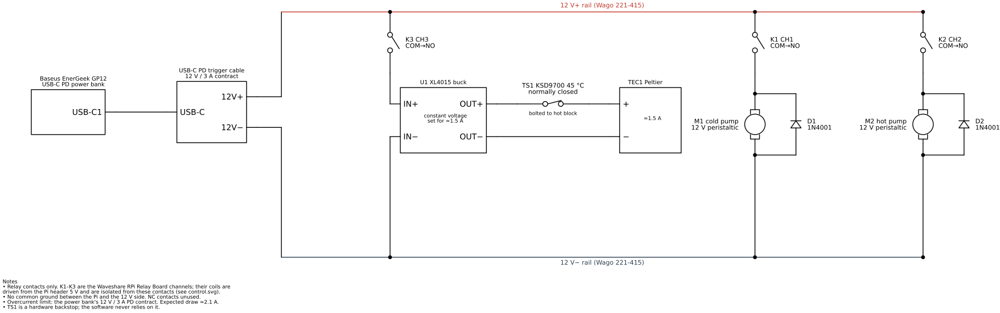
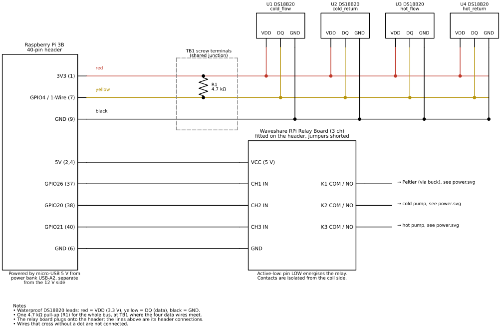
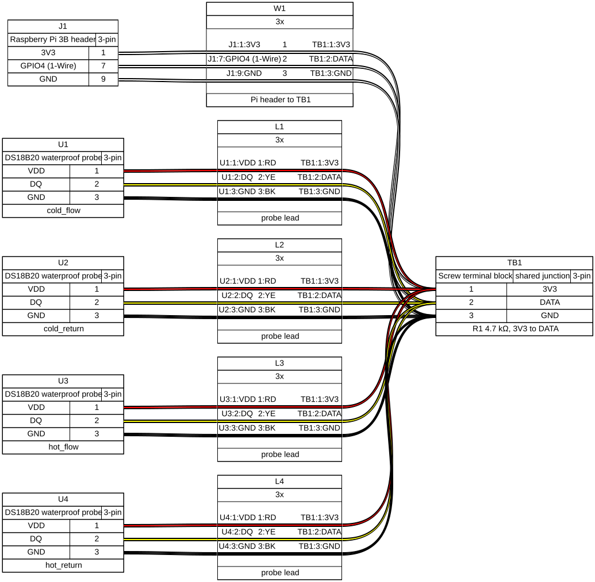

# Wiring

These diagrams document the rig as built. Regenerate the SVGs after editing
`build.py` or `harness-sensors.yml`:

```sh
.venv/bin/pip install -e '.[docs]'     # schemdraw, wireviz
sudo apt install graphviz              # for the WireViz harness only
.venv/bin/python docs/wiring/build.py
```

CI runs `build.py --check`, which fails if `power.svg` or `control.svg` no
longer matches `build.py`. It doesn't check `harness-sensors.svg`, because
its layout varies between Graphviz versions.

## 12 V power side



The relays switch the + side of each load. CH1 switches the buck converter's
*input*, so the Peltier current is still set by the buck (constant voltage,
adjusted on the bench for about 1.5 A). The KSD9700 cutout sits in the
Peltier's + lead, after both the relay and the buck, and is bolted to the hot
water block. Each pump has a 1N4001 flyback diode across its terminals, with
the cathode to +.

### Power wire list

| Wire | From | To | Notes |
|---|---|---|---|
| W1a | PD trigger 12V+ | Wago 12 V+ rail | |
| W1b | PD trigger 12V− | Wago 12 V− rail | |
| W2a | Wago 12 V+ rail | K1 (CH1) COM | |
| W2b | Wago 12 V+ rail | K2 (CH2) COM | |
| W2c | Wago 12 V+ rail | K3 (CH3) COM | |
| W3 | K1 NO | U1 buck IN+ | |
| W4 | U1 buck IN− | Wago 12 V− rail | |
| W5a | U1 buck OUT+ | TS1 cutout | |
| W5b | TS1 cutout | TEC1 Peltier + | |
| W6 | U1 buck OUT− | TEC1 Peltier − | |
| W7a | K2 NO | M1 cold pump + | D1 cathode here |
| W7b | M1 cold pump − | Wago 12 V− rail | D1 anode at M1 − |
| W8a | K3 NO | M2 hot pump + | D2 cathode here |
| W8b | M2 hot pump − | Wago 12 V− rail | D2 anode at M2 − |

Each Wago 221-415 has 5 positions. Four are used on each rail, leaving one
spare. The relay NC terminals are unused.

## Pi side: relay board and 1-Wire bus



The relay board plugs onto the Pi header, so its connections are the header
pins themselves. It is active-low and takes its coil supply from the
header's 5 V. Its contacts are isolated from the coil side, and there is no
common ground between the Pi and the 12 V side.

## Sensor harness



All four probes join at TB1 with the Pi's three wires. The single 4.7 kΩ
pull-up R1 sits across 3V3 and DATA at TB1. Lead colours are the DS18B20
standard: red = VDD, yellow = DQ, black = GND. The colours of the Pi-to-TB1
wires (W1) aren't specified.
